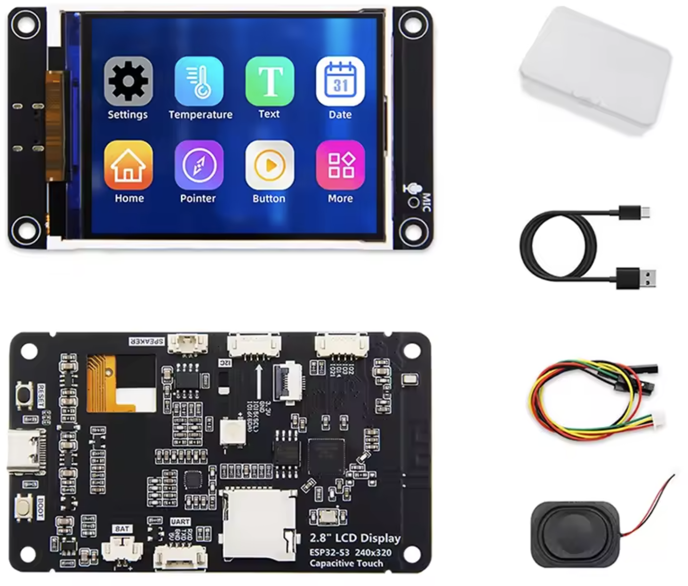

# ES3C28P

ES3C28P is the name of a cool little ESP32S3-based device sold on AliExpress which includes a 2.8" LCD SPI display based on the ILI9341 chip and a capacitive touchscreen using the FT6336 chip.



The documentation that was provided is cryptic at best and dubious in certain respects, like suggesting to drop in replacement files (which I could not locate) in some Arduino libraries. This library is a clean way to use that device without making any changes to the standard Arduino libraries. It configures the LCD and connects it to the TFT_eSPI library, and then instantiates LVGL 9.6 on top of it. It also configures the touchscreen and integrates it into the LVGL input device framework.

There are no special helper functions needed to access the UART or I2C pins on the back of the device, this can be done with the standard Arduino or ESP libraries.

The library was tested with a portrait orientation with the USB cable at the bottom (i.e. short LCD side horizontal) and will likely require some adjustments to support the other 3 possible orientations, especially for mapping touchscreen coordinates to screen coordinates. This improvement is planned in the short term so look out for library updates.

The device also has a speaker output, battery input, and microphone input. A welcome improvement to this library would be to provide functions to interface with those devices easily. There are no plans to do this but we would welcome a pull request to integrate them.

# Arduino IDE settings
Compiling programs for this board requires the following settings in Arduino IDE:

- USB CDC on Boot: ENABLED
- CPU Frequency: 240MHz
- Flash Mode: DIO 80MHz
- Flash Size: 16MB (128Mb)
- Partition Scheme: Huge APP (3MB OTA...)
- Upload Mode: UART0 / Hardware CDC
- Upload Speed: 921600
- USB Mode: Hardware CDC and JTAG

# Usage
In order to use the library, add it to your Arduino IDE (search for **ES3C28P** in the library window and install it). Then create your sketch. For compilation to work, we need to give compiler directives to the Arduino IDE by including a `build_opt.h` file in the same folder as your sketch file. Take the `build_opt.h` file from the `examples/basic` folder in this library and simply copy it to the same folder as your sketch file. The `build_opt.h` file must contain the following directives (see `es3c28p.h` for additional details) and the file in the examples has them:

```
-DUSER_SETUP_LOADED=1
-DLV_CONF_SKIP
-DILI9341_DRIVER=1
-DTFT_WIDTH=240
-DTFT_HEIGHT=320
-DTFT_MISO=13
-DTFT_MOSI=11
-DTFT_SCLK=12
-DTFT_CS=10
-DTFT_DC=46
-DTFT_RST=-1
-DTFT_BL=45
-DTFT_BACKLIGHT_ON=HIGH
-DTFT_INVERSION_ON=1
-DUSE_HSPI_PORT=1
-DSPI_FREQUENCY=27000000
-DSPI_READ_FREQUENCY=16000000
```

A minimal sketch would look like this:
```
#include <es3c28p.h>

ES3C38P *board = nullptr;

void setup() {
  board = &ES3C38P::getInstance();

  Serial.begin(115200);
  delay(1000);

  board->begin();
  Serial.println("Board initialized");
}

void loop() {
  board->loop();
  vTaskDelay(pdMS_TO_TICKS(5));
}

```

# Example

The `examples/basic` program in the library displays a Squareline Studios-generated UI with a simple checkbox, draws an LVGL object, and handles drag and click touch events. Just open the `basic.ino` sketch file in Arduino IDE and click Upload. The first compilation will take several minutes as dependent libraries are compiled.


# Future Improvements

It would be nice to enable all the features of the device in this library, which would include the following:

- Support for different screen orientations
- Full initialization of all components
- LCD power ON/OFF and reset
- Backlight intensity setting
- Light and Deep Sleep functionality
- Speaker and microphone

# Contact Information

For more information, bug reports, etc., contact [Charles Vaillancourt](mailto:charles.vaillancourt@gmail.com).
